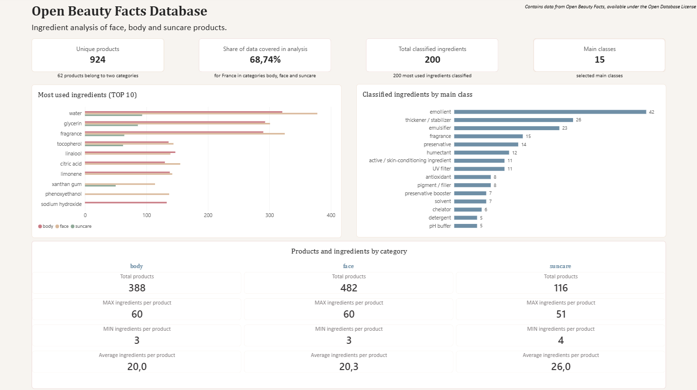
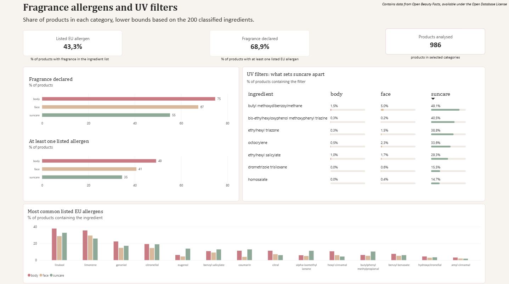

##Ingredient analysis of body, face and suncare cosmetics available in France. 

##Data Source and Licensing:

Code, SQL queries, classification and analysis: MIT License (see LICENSE).

Data: this project contains data from Open Beauty Facts, available under the Open Database License (ODbL) v1.0: https://opendatacommons.org/licenses/odbl/1-0/. 
Downloaded 15.10.2026 from https://world.openbeautyfacts.org. 
Files in tables/ and the Excel files in powerbi/ are derived from this database and are shared under the same ODbL license.

The ODbL applies to the source database and qualifying derivative databases. 

The data was processed and analyzed for a non-commercial portfolio project using Python, Excel, SQL, and Power BI.

## Project information

Python - data cleaning and preparation
Excel - ingredient classification
SQL - data analysis
Power BI - data visualization
Written summary  (PDF format)

924 products with valid ingredient list (62 products can be assigned to more than one category):
body: 388 products
face: 482 products
suncare: 116 products
manually classified 200 ingredients (divided into 15 main classes added flag for EU allergens): 68.7% of all ingredients covered

## Project Dashboards

### Overview

### Details

## Full Summary

[View the full summary (PDF)](docs/summary.pdf)

## Power BI Dashboard

[Open the Power BI dashboard file](powerbi/visualization.pbix)

## Key findings

All categories - body, face and suncare share the same core: water, glycerin and fragrance as TOP 3 most commonly used ingredients.
Face and body products are very similar in composition.
In suncare category, most popular UV filter is butyl methoxydibenzoylmethane (49.1% of all suncare products).
Fragrance is declared in 75% of body products,  67% of face products and 55% of suncare products.
Products with at least one allergen in INCI: for body products -  49%, face  - 41% and suncare -  35%
Most common allergens for all categories are linalool, limonene and geraniol.

Repository structure:
|- README.md
|- LICENSE
|- requirements.txt
|- data/raw    [products.csv should be here, see below]
|- python/
|-|- openbeauty.py (cleaning, preparing and export of tables)
|-|- build_powerbi_xlsx.py (build xlsx files for Power BI)
|- sql/
|-|- 01_schema.sql
|-|- 02_queries.sql (data analysis)
|- classification/
|-|- ingredients_classification.csv (200 ingredients classified manually)
|- tables/ (product tables exported by openbeauty.py)
|- powerbi/ ( visualisation and Excel source files)

## Limitations:
User-contributed data: typos and name variants remain, so counts of some ingredients may be understated
Classification and allergen flags cover the top 200 ingredients (68.7% of occurrences) only
INCI lists give no concentrations of each ingredient; a listed ingredient does not mean a harmful product
Products with several categories are counted in each
Suncare sample is small (116)
Colour Index pigments (e.g. CI 77891) were removed by the junk filter, so ingredient counts of tinted products are understated. 
Names ending in a closing bracket lost it during cleaning (255 of 19,219 entries, 138 products), so some variants were not merged (e.g. paraffinum liquidum 106 products plus about 32 in unmerged variants) 

## How to reproduce
1. Download the Open Beauty Facts CSV export ([https://world.openbeautyfacts.org/data](https://world.openbeautyfacts.org/data))
   and save it as “data/raw/products.csv” [mentioned in repository structure]

2. Install dependencies: “pip install -r requirements.txt” (pandas, openpyxl)

3. Run from the project root:
python/openbeauty.py
python/build_powerbi_xlsx.py

 The first script (openbeauty.py) cleans the data and writes the tables to “tables/”. 
 The second one builds the SQLite tables and views from “sql/” and exports “open_beauty_power_bi.xlsx” and “class_counts_ranking10.xlsx” for Power BI.
 
4. Open “powerbi/visualization.pbix” and click Refresh. If Power BI cannot find the files,
   change the paths in File → Options and settings → Data source settings.

## Author
Justyna Karczmarz · [LinkedIn]

